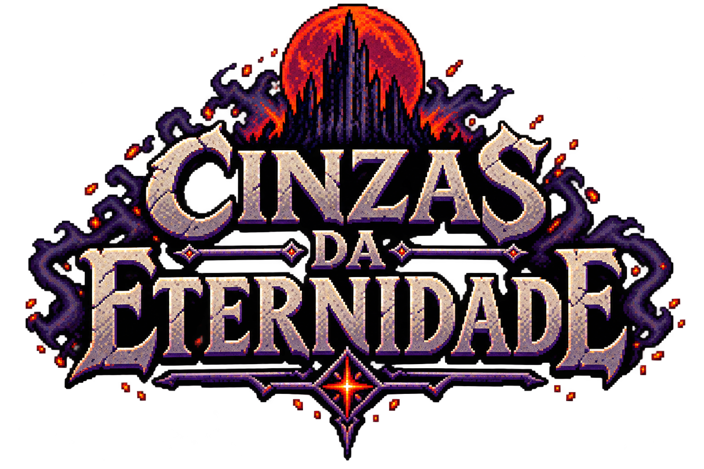
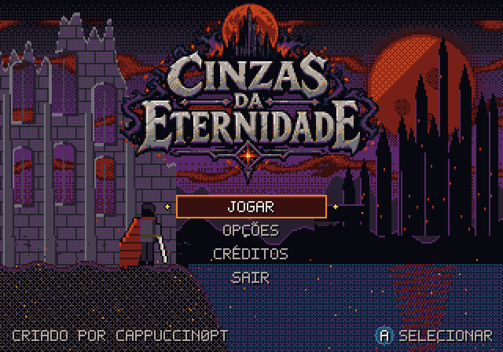
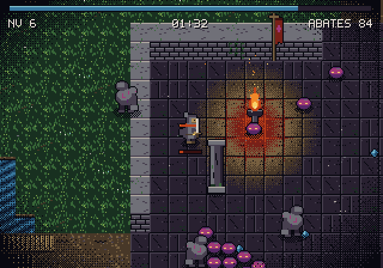

# Cinzas da Eternidade — Sega 32X

Sobrevivência por hordas no estilo de Vampire Survivors. O herói ataca sozinho; tu só controlas o movimento. Os inimigos chegam cada vez em maior número, deixam cristais de experiência e cada nível novo dá a escolher uma de três melhorias. O objetivo é sobreviver 10 minutos até ao amanhecer.







## Controlos

| Botão | Ação |
| --- | --- |
| Direcional | Mover (e escolher a melhoria no menu) |
| A, B ou C | Confirmar a melhoria; com a espada em modo manual, cada clique é um golpe |
| START | Começar, pausa |

## Cutscene de abertura

Ao ligar a consola, antes do título, corre uma cutscene de 40 segundos sincronizada com `musica/intro.mp3` (START ou A saltam-na):

| Tempo | Cena | Legenda | Som |
| --- | --- | --- | --- |
| 0–5 s | A fortaleza em ruínas sob a lua vermelha | "HÁ MIL ANOS, A MORTE FOI DERROTADA." | Trovão aos 3 s |
| 5–10 s | A câmara percorre a aldeia em chamas com mortos-vivos | "MAS A ETERNIDADE TEM FOME." | Fogo aos 6 s |
| 10–15 s | Aren caído no cemitério; uma brasa aproxima-se | Aren: "AINDA... NÃO." | |
| 15–20 s | Aren ergue-se e a espada incendeia-se | Aren: "QUEM ME CHAMOU?" | Espada aos 16 s |
| 20–25 s | A horda ataca e Aren corta-a | Aren: "ENTÃO VENHAM." | Ossos aos 21 s |
| 25–31 s | O Gorgomusgo sai da cripta | Gorgomusgo: "A TUA ORDEM MORREU CONTIGO." | Porta da cripta aos 26 s |
| 31–36 s | Confronto sob a lua | Aren: "ENTÃO VAIS MORRER OUTRA VEZ." | Impacto aos 32 s |
| 36–40 s | O logótipo surge e desfaz-se em cinzas | "SOBREVIVE. EVOLUI. RECORDA." | Confirmar aos 38 s |

As personagens da cutscene são as do jogo (o ninja, aqui chamado Aren, e o Gorgomusgo), ampliadas ao dobro com Scale2x a partir dos mesmos desenhos, com sombreado e detalhes acrescentados.

Os efeitos da cutscene (`sons/trovao.wav`, `fogo.wav`, `ossos.wav`, `porta.wav`, `impacto.wav`, `confirmar.wav`) foram sintetizados com `tools/sintetizar_sfx.py` e podem ser trocados por gravações próprias com o mesmo nome.

## Ecrã de título

Menu com **JOGAR** (leva à escolha do personagem), **OPÇÕES** (espada do ninja automática ou manual; música ligada ou desligada), **CRÉDITOS** e **SAIR** (despede-se e volta ao título, porque numa consola não há para onde sair).

O título é animado:
- as nuvens deslizam pelo céu;
- a lua e o reflexo no lago pulsam (ciclos de paleta);
- sobem brasas e caem relâmpagos de vez em quando;
- o herói na falésia tem a capa ao vento e a estrela do logótipo brilha.

O logótipo vem de `arte/logo.png`, convertido para a paleta do jogo com `tools/converter_logo.py` (precisa do Pillow; só é preciso correr quando o logótipo mudar, porque o `src/logo.h` gerado fica no repositório).

## HUD

- **Canto superior esquerdo:** retrato do personagem, vida (com valor), caixa do nível e barra de experiência.
- **Topo ao centro:** relógio.
- **Canto superior direito:** caveira e número de abates.
- **Fundo ao centro, durante o combate com o boss:** caveira com chifres, placa com o nome e barra de vida.

As molduras são sprites gerados em `tools/gerar_assets.c`; os valores são desenhados por cima pelo jogo.

## Personagens

Escolhe-se no título (linha "PERSONAGEM", com A ou esquerda/direita). As melhorias passivas são comuns aos dois.

| Personagem | Vida | Armas |
| --- | --- | --- |
| Ninja | 100 | Lâmina (automática ou manual), Brasas orbitais, Faúlha |
| Feiticeira | 85 | Bola de Fogo, Mísseis Arcanos, Buraco Negro, Relâmpago em Cadeia |

**Magias da feiticeira** (5 níveis; a melhoria seguinte ao nível 5 é a evolução):

| Magia | Níveis 2 a 5 | Evolução |
| --- | --- | --- |
| Bola de Fogo: explode em área | explosão maior, +1 bola, queima os inimigos, +dano e +1 bola | Chuva de Meteoros: meteoros caem à volta, com aviso vermelho no chão |
| Mísseis Arcanos: perseguem os inimigos | +1 míssil, mais velocidade, 1 ricochete, +2 mísseis e +1 ricochete | Barragem Arcana: 24 mísseis seguidos |
| Buraco Negro: puxa os inimigos e fere-os | raio maior, mais força de atração, dura mais, +raio e +dano | Singularidade: atrai com mais força e explode no fim |
| Relâmpago em Cadeia: salta entre inimigos | +1 salto, mais alcance, +1 salto e críticos, +2 saltos | Deus do Trovão: raios caem sobre inimigos à tua volta |

## Conteúdo

**Armas** (atacam sozinhas):

| Arma | Efeito | Nível máximo |
| --- | --- | --- |
| Lâmina | Corte em arco, alternando entre a frente e as costas; a partir do nível 4 corta para os dois lados | 6 |
| Brasas orbitais | Brasas que rodam à volta do herói | 5 |
| Faúlha | Projéteis contra os inimigos mais perto | 5 |

**Melhorias passivas:**

| Melhoria | Efeito | Nível máximo |
| --- | --- | --- |
| Coração de pedra | +20 de vida máxima e cura | 5 |
| Botas de vento | +10% de velocidade | 5 |
| Íman de brasa | Recolhe cristais de mais longe | 4 |
| Fúria | −8% de tempo de recarga | 4 |

**Inimigos:** o rastejante (rápido e frágil, fere por contacto) e o esqueleto (mais resistente, a partir dos 40 segundos). O esqueleto ataca com uma lâmina em brasa: quando chega perto, para, ergue a lâmina durante meio segundo com o olho vermelho e golpeia à frente. A vida dos inimigos cresce com o tempo e, a cada minuto, uma horda fecha um anel à volta do herói.

**Mapas:** dois mapas de 96×96 tiles (1536×1536 píxeis), com scroll. O nome do mapa aparece ao entrar.

1. **Pátio da Fortaleza:** no nível 15 aparece o boss **Gorgomusgo, o tronco que devora runas**, com uma apresentação própria (barras de cinema, nome letra a letra em letras grandes, relâmpago). Persegue o herói, avisa com os olhos a vermelho, investe e chama rastejantes; passa por cima de muros e água. Quando morre, abre-se um portal no centro do mapa e uma seta à volta do herói aponta para ele.
2. **Aldeia de Hinosato:** aldeia japonesa destruída, com casas de madeira em chamas e desabadas, torii, lanternas de pedra, cerejeiras queimadas e arrozais alagados. Sobrevive 5 minutos até ao amanhecer.

**Pátio da Fortaleza em pormenor:** mapa com scroll. Tem um pátio da fortaleza com muralhas, portões, pilares e estandartes; um rio com pontes; um lago; um cemitério; um santuário corrompido com runas; ruínas; e floresta à volta.

**Música:** `musica/Arcade_Rush.mp3` no título e no Pátio da Fortaleza, `musica/aldeia.mp3` na Aldeia de Hinosato e `musica/intro.mp3` na cutscene, comprimidas em IMA ADPCM (4 bits, 11 025 amostras por segundo) e tocadas pelo PWM do 32X a 22 050 por segundo, com interpolação.

**Efeitos sonoros:** golpe da espada (`sons/attack.wav`), dano no herói (`sons/hurt.wav`), subida de nível (`sons/powerup.wav`), aparecimento do boss (`sons/monster.wav`) e entrada no portal (`sons/teleport.wav`). O golpe tem uma voz própria, para não cortar os outros efeitos.

**Efeitos de cenário:**
- **Ciclos de paleta:** a água ondula, as runas pulsam e a luz dos braseiros treme.
- **Relâmpagos:** a paleta inteira clareia de tempos a tempos.
- **Partículas:** brasas a subir dos braseiros, cinza a cair e pirilampos na relva.
- **Vinheta pontilhada** e sombras de contacto.

## Gerar a ROM no GitHub

1. Envia esta pasta para um repositório, incluindo a pasta escondida `.github`.
2. No separador **Actions**, corre **Gerar ROM 32X**. A primeira vez compila a toolchain do Marsdev (pode passar de 1 hora); depois fica em cache.
3. Descarrega o artefacto `cinzas-da-eternidade-32x` e abre a ROM `cinzas-da-eternidade.32x` no Ares, no PicoDrive ou no Kega Fusion, ou numa flashcart.

O workflow copia o exemplo `32x-skeleton` do Marsdev (arranque do 68000 e do SH-2, cabeçalho da ROM, leitura do comando), gera a arte com `tools/gerar_assets.c` e junta `src/main.c`, `src/mundo.h` e `src/assets.h`.

## Notas técnicas

- **Arte gerada no PC:** sprites, tiles, mapa, adereços e fonte são gerados por `tools/gerar_assets.c` e gravados na ROM. A consola não faz cálculos pesados no arranque.
- **Scroll:** os tiles são copiados para o ecrã em palavras de 16 bits. Quando a câmara está num píxel ímpar, o registo SFT do 32X desloca o ecrã 1 píxel.
- **Sprites:** são escritos na área de sobreposição do framebuffer, onde os bytes a 0 são transparentes. Cada sprite tem variantes pré-calculadas: espelhada, deslocada 1 px e a branco quando é atingida.
- **Paleta:** só é escrita quando o VDP o permite (bit PEN), porque o hardware real ignora escritas fora desse intervalo.
- **Efeitos sonoros:** o workflow converte os WAV de `sons/` com `tools/converter_sfx.py` para `src/sfx.h`. O SH-2 secundário soma-os à música em duas vozes (golpe da espada e restantes efeitos); o SH-2 principal pede cada efeito através de variáveis partilhadas.
- **Música:** o workflow converte os MP3 de `musica/` com o ffmpeg e `tools/converter_musica.py` para `src/musica.h`, em IMA ADPCM (4 bits por amostra, metade do espaço de 8 bits). O SH-2 secundário corre `src/slave.c`: descomprime em tempo real, interpola para 22 050 Hz, mistura os efeitos e escreve no PWM sempre que a fila tem espaço. Troca de faixa quando o SH-2 principal muda de mapa ou entra na cutscene.
- **Comando:** o 68000 lê-o no seu ciclo principal e passa-o ao SH-2 por COMM8 e COMM10. O workflow corrige o código de arranque do exemplo (`m68k_crt1.s`) com `tools/corrigir_crt1.py`: no exemplo o comando era lido na interrupção de fim de imagem, cujo código está na ROM, e no hardware real e no MiSTer o 68000 ficava preso à espera da ROM enquanto os SH-2 a liam. Agora o 68000 trabalha sem interrupções e sem tocar na ROM depois do arranque.
- **Velocidade:** a lógica corre a 60 passos por segundo medidos pelo temporizador FRT do SH-2. Se a consola desenhar menos imagens, o jogo mantém a velocidade.
- **Desempenho:** todo o desenho é feito no SH-2 principal. Se a imagem ficar lenta com muitos inimigos, o passo seguinte é pôr o SH-2 secundário a desenhar metade do ecrã.

## Trocar a música

Substitui `musica/Arcade_Rush.mp3` (ou muda o nome no workflow). Para ouvir no PC como vai soar no 32X:

```
ffmpeg -i musica/Arcade_Rush.mp3 -ac 1 -ar 8000 -f s16le musica.raw
python3 tools/converter_musica.py musica.raw 8000 --wav previsualizacao.wav
```

Uma faixa mais curta permite uma taxa maior: com cerca de 2 minutos cabem 11025 Hz. O workflow falha com uma mensagem clara se a ROM passar dos 4 MB.

## Mudar a arte ou o mapa

Edita `tools/gerar_assets.c` e volta a correr o workflow; o `src/assets.h` é regenerado. Para testar no PC:

```
gcc -O2 -std=gnu99 -o gerar tools/gerar_assets.c -lm && ./gerar > src/assets.h
```

O `src/main.c` também compila no PC com `-DPREVIEW`, usando um framebuffer em memória. Foi assim que as imagens de pré-visualização foram geradas, sem emulador.
